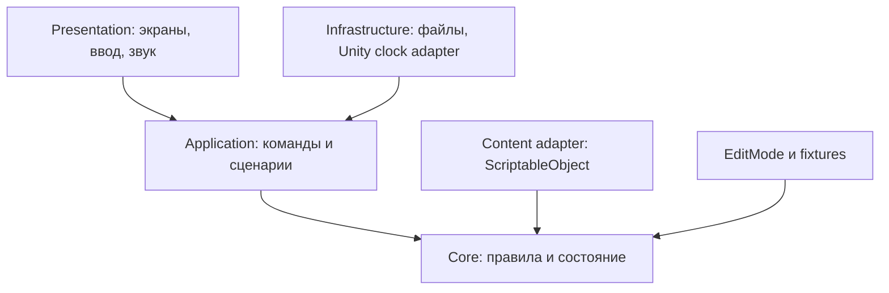

# Техническая архитектура нового Unity-проекта

## 1. Технологическая база и границы

Целевой Editor — Unity 6.6. В старом проекте прочитан номер **6000.6.5f1**, но это не проверка установки редактора или нового проекта. Для нового проекта зафиксировать фактически установленную совместимую версию в ProjectVersion.txt и отчёте M1; не обновлять старый проект. Рабочая рекомендация — тот же 6000.6.5f1, если доступен в Unity Hub.

2D, URP, C#, портретный Android. Выбрать один UI-стек для первого среза; предложение — uGUI с русскоязычным текстом и проверенными шрифтами. Версии Input System, URP и Test Framework брать из совместимого шаблона нового Editor, зафиксировать manifest и lock-файл. Не копировать старый manifest целиком. ECS/DOTS, DI-фреймворк, сторонняя сериализация и Addressables не являются обязательными зависимостями v1.

Unity 6.6 указывает Android 8.0/API 26 как минимум, OpenGL ES 3.1 как минимальную поддерживаемую GLES-версию; поддерживаются Vulkan и GLES 3.2. Это требования движка, не обещание быстродействия игры. Проверить соответствие телефона и Build Profile. Источник: [Unity 6.6 Android compatibility](https://docs.unity3d.com/6000.6/Documentation/Manual/android-requirements-and-compatibility.html), просмотрено 23.10.2026.

Android-сборка: IL2CPP, ARM64, APK для локального теста. Публикация, подпись release-ключом, target API магазина и AAB — отдельный этап; не объявлять актуальные правила магазина проверенными этим пакетом. SDK/NDK/JDK — комплектация Android-модуля выбранного Editor, сверить её в Hub и External Tools, не обновлять вслепую.

## 2. Направление зависимостей



Core не зависит от UnityEngine, MonoBehaviour, UI, файловой системы, DateTime или сети. Application координирует атомарные операции и порты; Infrastructure реализует порты, подключается в Bootstrap. Presentation получает снимки/события, но не меняет поля доменного состояния напрямую. ScriptableObject — авторские определения, при старте конвертируются в неизменяемые Core DTO. Изменяемое состояние игрока не записывается в ассеты.

Начать с небольшого числа сборок: `ServerClosed.Core`, `ServerClosed.Application`, `ServerClosed.Infrastructure`, `ServerClosed.Presentation`, `ServerClosed.Editor`, тестовые сборки. Пространства имён внутри Core: Time, Life, Soul, Genetics, Rpg, Combat, World. Создавать сложную шину сообщений или микросервисы не требуется.

## 3. Предлагаемая структура

```text
ServerClosed_New/
  CLAUDE.md
  Docs/Launch/              пакет требований
  Docs/Audit/               отчёт M0 и решения
  Docs/Validation/          таблицы прогонов и ссылки на логи
  Game/
    Assets/_Project/
      Scenes/Bootstrap.unity
      Scenes/Prototype.unity
      Scripts/Core/{Time,Life,Soul,Genetics,Rpg,Combat,World}/
      Scripts/Application/
      Scripts/Infrastructure/{Persistence,Content}/
      Scripts/Presentation/{UI,World,Combat}/
      Editor/
      Data/{Rules,Units,Regions,Events}/
      Tests/{EditMode,PlayMode,Fixtures}/
    Packages/
    ProjectSettings/
  Artifacts/               тестовые XML, логи и APK, вне Git по умолчанию
```

Структура — предложение для нового проекта. Создавать её только в M1. Сцены и ScriptableObject создавать средствами Unity/Editor-утилит нового проекта, сохранять .meta и GUID. Не писать вручную неподтверждённый YAML сцен и не переносить GUID из старой игры.

## 4. Модель состояния

| Объект | Ключевые поля | Срок жизни |
|---|---|---|
| SaveEnvelope | schemaVersion, rulesVersion, contentVersion, generation, checksum, payload | Слот сохранения |
| GameState | world, soul, currentLife, pendingOperation, commandSequence | Кампания |
| WorldState | worldId, seed, worldMinute, regions, settlements, npcIndex, eventQueue, chronicle | Между жизнями |
| SoulState | soulId, memoryBalance, lifetimeMemory, karma, unlockedGifts, completedLifeIds | Между жизнями |
| LifeState | lifeId, bodyId, birthMinute, lifePhase, stats, skills, inventoryIds, questState | Одна жизнь |
| BodyState | genome, wounds, lastMortalityDay, vitalStatus, locationId | Тело/NPC |
| RebirthState | deathId, rewardCommitted, originOffers, chosenOriginId, targetAdultMinute, progress | Переживает сбой |
| BattleState | battleId, initialSnapshot, tick, commands, RNG states, resultStatus, timeRemainder | Один бой |
| ItemInstance | itemId, definitionId, ownerId, modifiers | Пока предмет существует |
| WorldEvent | id, dueMinute, priority, type, versionedPayload, causeId | До обработки/архива |

`currentLife` содержит ссылки на мир, а не копию всего мира. Новая жизнь заменяет только LifeState и назначает другое BodyId; ссылка на WorldState и worldId остаётся. `soul` не включает город или запас пищи поселения.

Списки/словари в Core допускаются, но сериализуются в стабильном порядке по ID. DTO содержат только поддерживаемые сериализатором поля; полиморфные объекты, словари и циклические ссылки не передавать в JsonUtility без адаптера. В срезе достаточно явных списков DTO и typeId для событий. Не использовать BinaryFormatter.

## 5. Команды и владение данными

Минимальные команды: StartTravel, StartTraining, Rest, EnterBattle, SubmitBattleOrder, FinalizeBattle, EndLife, ChooseOrigin, UnlockGift, SelectActiveGifts, ContinueChildhood, SaveRequested. Каждая несёт commandId, ожидаемый stateRevision и параметры. Команда валидируется до мутации; ошибка не меняет состояние и возвращает понятную причину.

Контракт обработки:

```text
validate(command, state, rules)
  -> rejected(reason) ИЛИ
stage(candidateState, domainEvents)
validateInvariants(candidateState)
persistCriticalTransition(candidateState)  // если завершение жизни/награда/переход
publish(candidateState, events)
```

Критическую награду не показывать как окончательно полученную до успешной записи. При ошибке записи UI предлагает повтор и не выполняет следующий необратимый переход. Для обычного перемещения можно сохранять контрольную точку с явно ограниченной потерей последнего действия при аварии; для наград и смерти нужен commit до подтверждения пользователю.

Idempotency: завершённые lifeId и deathId хранятся постоянно в компактном реестре; результат боя имеет committed flag; временные commandIds хранятся ограниченным кольцом, но повтор опасной операции дополнительно запрещается состоянием автомата. Одного короткого кеша commandId недостаточно для повторного EndLife через неделю.

## 6. Время и порядок событий

`IWorldSimulation.AdvanceTo(targetMinute, cancellation)` возвращает completed/pausedAtBoundary/blocked и фактическую дату. Реализация проходит ближайшую границу события/суток/сезона, а не каждую минуту пустого периода. Дневные шаги пропускать нельзя, если они содержат старение/демографию. Между порциями вычислений можно отдать управление кадру, но не разрешать игровые команды до согласованного снимка.

Долгий проект и детство хранят targetMinute и progressMinute; после перезапуска продолжение идёт с последней целой границы. Последовательность событий полностью определена W-09. `WorldMinute` не продвигается вперёд, пока все регионы не завершили очередную границу.

Бой может пересечь полночь, хотя обычно короток. На такой границе глобальный дневной шаг выполняется один раз; естественная смерть героя завершает бой событием смерти. UI и боевой автомат должны обработать этот случай. В фоне не рассчитываются отдельные «локальные сутки».

## 7. Детерминизм

Именованные случайные потоки: WorldGeneration, Economy, Ecology, Mortality, Genetics, Encounter, Battle, OriginOffers. У каждого определены seed, алгоритм, версия и состояние/счётчик. Не использовать UnityEngine.Random, системное время или `string.GetHashCode()` для решений игры. Выбрать небольшой явно реализованный генератор с тестовыми векторами; алгоритм и преобразование ID в seed закрепить в правилах M2.

Пример схемы seed: hash64(worldSeed, subsystemId, entityId, eventId, rulesVersion). Это спецификация входов, не готовая реализация хеша. Требуется стабильная кодировка UTF-8, порядок байтов и неизменные тестовые векторы.

Цель v1: повторяемость симуляции при одинаковых данных, командах и версии правил, включая Editor и IL2CPP. Боевые и экономические расчёты — целые/фиксированная точка. Для вероятности старения использовать версионированную таблицу порогов вероятности, вычисленную из формулы A-03 и проверенную тестами; не полагаться на побитовое совпадение Math.Exp на разных платформах. Шаг таблицы — 1 мировой день возраста, healthRisk выбирается из допустимых дискретных комбинаций. Сравнение случайного целого с целым порогом. До подтверждения на Android кроссплатформенный детерминизм считается целью, не фактом.

Хеш состояния вычислять по каноническому снимку игровых данных; не включать путь файла, timestamps записи, UI-анимации или порядок словарей. Golden replay включает rulesVersion и contentVersion, иначе старый результат нельзя честно сравнить с новым балансом.

## 8. Сохранения и восстановление

Новая игра имеет отдельный product/company identity и отдельный persistentDataPath. Не открывать старый profile.json и не мигрировать его автоматически. Старый проект относится к другой игре. Для новой игры с первого дня ввести schemaVersion=1, далее последовательные миграции `vN → vN+1` на копии данных с сохранением оригинала.

Предложение: двухслотовая запись `save_A.json` и `save_B.json` плюс временный файл. В каждый момент хотя бы один проверенный слот сохраняется нетронутым.

1. Построить DTO, посчитать checksum по точно определённым байтам payload, присвоить generation+1.
2. Записать временный файл в той же директории, закрыть/сбросить буферы доступным платформе способом.
3. Повторно прочитать и проверить JSON, checksum, версии и доменные инварианты.
4. Заменить **старший по давности** слот проверенным файлом, не трогая последний валидный слот. Сбой во время замены может испортить заменяемый слот, но другой остаётся.
5. При загрузке проверить оба слота и выбрать максимальный валидный generation. Файл tmp не считать подтверждённым автоматически; использовать только по отдельной процедуре восстановления после проверки.

Checksum обнаруживает повреждение, не защищает от намеренного читерства. Зашифровывать локальную игру ради видимости защиты не требуется.

Если оба слота повреждены — показать выбор восстановления/новой кампании и сохранить повреждённые файлы для диагностики, не молча создавать новый профиль поверх них. Если версия из будущего — запретить загрузку с сообщением, а не подставлять значения по умолчанию.

Автосохранение: после завершения команды с наградой, завершения жизни, выбора происхождения, завершения дневного пакета детства, смены региона; на OnApplicationPause — дополнительная попытка. Нельзя полагаться только на OnApplicationQuit, потому что мобильный процесс может быть завершён без него.

Бой сохраняет полный BattleState либо начальный снимок + команды + checkpoint такта; выбрать один вариант в M4. Предпочтение среза — полный DTO с RNG и таймерами. Перезапуск не выдаёт награды повторно и не возвращает затраченную ману. Пауза телефона не меняет WorldMinute.

## 9. Производительность Android

Предварительный профиль цели: физический ARM64-телефон с 4 GB RAM, Android ≥8 и поддерживаемой графикой. **Конкретная модель не выбрана**, поэтому эти бюджеты пока не подтверждены измерениями.

| Метрика | Бюджет первой версии | Как измерять |
|---|---|---|
| Частота кадров | 30 FPS; p95 кадра ≤33.3 ms в бою | 10 минут на устройстве после прогрева |
| Основная симуляция боя | p95 ≤3 ms на 100-ms шаг | ProfilerMarker в Development Build |
| GC в устойчивом бою | 0 B на такт Core после прогрева | Profiler; UI оценивать отдельно |
| Пиковая память процесса | ≤700 MB | Device profiler, холодный и длинный сеанс |
| Переход региона | ≤2 s, без зависания ввода >250 ms | Записанный маршрут |
| Детство 2160 дней | ≤10 s; отзывчивый индикатор | Максимальный штатный мир |
| Сохранение | ≤500 ms для файла ≤5 MB | Физическое хранилище, 20 повторов |
| Длинная сессия | 30 минут без crash/ANR | Телефон, бой/карта/пауза |

Если бюджет не выполняется, сначала уменьшать количество обновлений UI, аллокации, загрузку контента и необязательных сущностей; не менять правила мира скрыто. Пропуск времени допускает порции работы 2–4 ms/кадр. Корректность эквивалентна одному последовательному расчёту.

Пулы для боевых визуальных объектов, обновление UI по изменениям, атласы спрайтов, ограничение прозрачных слоёв. Не создавать по GameObject на каждого жителя региона. Asset loading вводить по измеренной потребности; три маленьких региона не требуют сложной потоковой системы.

## 10. Диагностика и сборка

Дев-панель показывает seed, worldMinute, lifePhase, stateRevision, lastSaveGeneration и число событий. Кнопки: advance 1 day / 30 days, тестовая смерть, экспорт обезличенного снимка. В release панель отключена. Никакие Gateway-ключи или настройки Claude не входят в Unity-проект и APK.

Логи: operationId, subsystem, duration, result; не весь инвентарь/профиль на каждом кадре. Для сборки хранить Editor version, packages lock hash, Git revision нового репозитория, Build Profile и sha256 APK. Каждый результат помечать «написано / скомпилировано / тесты / собрано / запущено на устройстве» отдельно.

Сборочные команды и Editor-методы добавлять после осмотра фактического нового проекта. Не копировать старый AndroidBuilder: он относится к другой игре и меняет PlayerSettings. Автоматический запуск Unity в исходной старой папке запрещён на этапе аудита.
